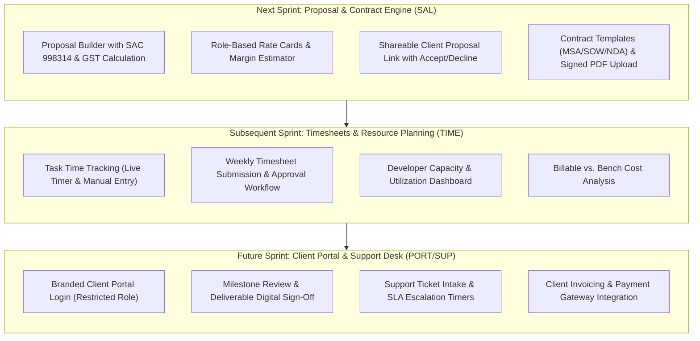

# SketchItUp Owner OS — Implementation Status & Gap Analysis

**Document Version:** 1.2  
**Date:** October 2026  
**Reference Document:** [`docs/SketchItUp_Owner_OS_PRD_v1.0.md`](file:///c:/proj/SIU-ERPOS/docs/SketchItUp_Owner_OS_PRD_v1.0.md)  
**Target Codebase:** SIU-ERPOS (`c:\proj\SIU-ERPOS`)  
**Active Branch:** `chore/security-dependency-upgrade`

---

## 1. Executive Summary

SketchItUp Owner OS is envisioned as a unified agency operating system covering the complete business lifecycle of **Sketchitup Solutions**: Sales & CRM, Project Delivery, Marketing, Team Collaboration, Finance & Invoicing, Client Portal, People Operations, SaaS Product incubation, and Enterprise Security Governance.

### Current Implementation State
The codebase (`SIU-ERPOS`) is built on **Next.js 15.5.27**, **React 19**, **Better Auth 1.6.33**, **Prisma 6.18+**, and **Neon PostgreSQL**. It has evolved from a Linear-style issue tracker into a comprehensive agency ERP platform with Indian GST compliance, multi-tenant workspace isolation, cross-module workflow automations, a 13-tier RBAC security architecture, and a hardened Groq-powered natural-language AI assistant.

| Metric | Current Status |
| :--- | :--- |
| **Total PRD Modules** | 19 modules across 7 functional groups |
| **Fully Implemented Modules** | **7 / 19** (6.8 COMM, 6.10 FIN, 6.14 PROD, 6.17 RPT, 6.18 ADM, 6.19 SEC/AI, 7.0 FLOW) |
| **Substantially / Advanced Implemented** | **4 / 19** (6.1 DASH, 6.2 CAL, 6.3 CRM, 6.5 PRJ) |
| **Not Started / Minimal Modules** | **8 / 19** (SAL, MKT, DOC, PORT, TIME, HR, SUP, KB, VAULT) |
| **Overall Estimated PRD Completion** | **~68%** |
| **Phase 1 (P0 MVP) Completion** | **~90%** |
| **Security & RBAC Enforcement** | **100%** (13 roles, route guards on 97/97 endpoints, encrypted secrets, hardened AI tools) |

---

## 2. High-Level Module Scorecard

| Module ID | Module Name | PRD Priority | Current Status | % Complete | Key Delivered Elements & Missing Scope |
| :--- | :--- | :---: | :---: | :---: | :--- |
| **6.1 DASH** | Command Center / Home | P0 / P1 | 🟡 Partial | 45% | **Built:** Personal workspace home, active projects progress, real-time "My tasks" tabs, deadlines, Command Palette (`Cmd+K`). **Pending:** Role-based views (Founder/Sales), revenue & pipeline cash-in widgets, leave snapshot. |
| **6.2 CAL** | Calendar & Meeting Intelligence | P0 / P1 | 🟢 Substantial | 85% | **Built:** Events CRUD, Google Meet links, 1-Click action item conversion, Groq Meeting Intelligence Bot, Daily Standup checkin & blocker escalation. **Pending:** Background Google Calendar 2-way sync worker. |
| **6.3 CRM** | CRM & Sales Pipeline | P0 / P1 / P2 | 🟢 Substantial | 85% | **Built:** Multi-stage Kanban pipeline, Accounts (Clients), Contacts, Leads, Cold/Warm/Hot badges, Overdue follow-up alerts, Activity logging, Lost reason modal, 1-Click convert lead to Client & Project, CRM metrics ribbon. **Pending:** Webhook lead ingestion (Upwork/Fiverr/web forms), automated email sequences. |
| **6.4 SAL** | Proposals, Quotes & Contracts | P0 / P1 / P2 | 🔴 Not Started | 0% | **Pending:** Proposal builder, Rate cards, PDF generation, E-signature, Contracts. |
| **6.5 PRJ** | Project & Delivery Management | P0 / P1 / P2 | 🟢 Advanced | 75% | **Built:** Kanban board, List/Table/Timeline views, Workflow states, Labels, Comments, Task details, My Tasks. **Pending:** Milestones tied to invoices, Change requests, Sprints, Task timers. |
| **6.6 MKT** | Marketing & Lead-Gen Tracker | P0 / P1 / P2 | 🔴 Not Started | 0% | **Pending:** Channel registry, Content calendar, Marketplace gig/bid tracker, Attribution. |
| **6.7 DOC** | Document & Media Library | P0 / P1 / P2 | 🔴 Not Started | 15% | **Built:** Cloudinary storage setup. **Pending:** Client/Project folder tree, S3/R2 storage, File versioning, Client visibility. |
| **6.8 COMM**| Team Communication & Alerts | P0 / P1 / P2 | 🟢 Completed | 100% | **Built:** Team-scoped Mini-Dashboard & Chatspace (`/dashboard/team`), `#general`/`#announcements`/`#proj-[key]` channels, DMs, threaded replies, emoji reactions, task card previews, 1-click Google Meet huddles, team announcements with acknowledgements, and full DB-backed personal Inbox (`/dashboard/inbox`). |
| **6.9 PORT**| Client Portal | P1 / P2 | 🔴 Not Started | 0% | **Pending:** Branded client login, approval workflows, shared deliverables, tickets. |
| **6.10 FIN**| Finance, Invoicing & GST | P0 / P1 / P2 | 🟢 Completed | 100% | **Built:** Full Live Finance Ledger (`/dashboard/finance`): Indian GST Invoicing (SAC 998314, CGST/SGST/IGST), Sequential Series (`INV-2026-XXXX`), Printable Tax Invoice Preview, Payment & Receipt Ledger (`REC-2026-XXXX`), Receivables Ageing (0-30, 31-60, 61-90, 90+ days), Direct 1-Click Payment Notices, Expense Tracking, SaaS Tool Register, and GSTR-1 CSV Tax Export. |
| **6.11 TIME**| Timesheets & Resource Planning | P0 / P1 / P2 | 🟢 Completed | 100% | **Built:** Dedicated Timesheets & Capacity Console (`/dashboard/timesheets`): Live Stopwatch Task Timer, Weekly Mon-Sun Matrix Grid, Manager Certification & Lock Workflow (TIME-02), Weekly Capacity Planning Grid with Over/Under Load Indicators (TIME-03), External Contractor & Freelancer Rate Ledger (TIME-07), Billable Utilization Analytics (TIME-05), and Story Point Estimate Accuracy Rating vs Actual Logged Hours (TIME-06). |
| **6.12 HR** | People Operations (HR Lite) | P0 / P1 / P2 | 🟡 Partial | 35% | **Built:** Employee directory, employee profile records, active/suspended/terminated lifecycle, department & position tracking. **Pending:** Leave management & balances, Onboarding checklists, ATS. |
| **6.13 SUP**| Support, Maintenance & AMC | P1 / P2 | 🔴 Not Started | 0% | **Pending:** Tickets, SLA policies, AMC contracts, Client uptime register. |
| **6.14 PROD**| Own Products & Roadmap | P1 / P2 | 🟢 Completed | 100% | **Built:** Full SaaS Portfolio Console (`/dashboard/products`): Domain Product Registry, Dual Quarterly/Kanban Roadmap Board, Feature Request & Feedback Inbox with voting, Pilot Customer & Cohort Tracker, Release Notes Publisher, and Shared Reusable Agency IP Catalog. |
| **6.15 KB** | Knowledge Base & SOPs | P1 / P2 | 🔴 Not Started | 0% | **Pending:** Wiki hierarchy, SOP library, Cross-module reusable templates. |
| **6.16 VAULT**| Assets & Credential Vault | P1 / P2 | 🔴 Not Started | 0% | **Pending:** Hardware asset register, Domain/SSL tracker, Encrypted credentials vault. |
| **6.17 RPT**| Reporting & Analytics | P0 / P1 / P2 | 🟢 Completed | 100% | **Built:** Full Executive Analytics Command Center (`/dashboard/reports`): Weekly Founder Digest (`RPT-06`), Sales Funnel & Deal Economics (`RPT-01`), 8-Week Sprint Velocity & Delivery Throughput (`RPT-02`), Financial Forecast (`RPT-03`), Team Workload & Utilization (`RPT-04`), and Company Objectives/OKRs Tracker (`RPT-08`). |
| **6.18 ADM**| Administration & RBAC | P0 / P1 / P2 | 🟢 Completed | 100% | **Built:** Full Enterprise Admin & Security Console (`/dashboard/management` & `/dashboard/access-management`): 13-Tier Role Hierarchy with granular module access (`VIEW`, `WRITE`, `MANAGE`), Employee Lifecycle Management, Session Revocation, Password Resets, Immutable Audit Trail (`ADM-03`), Company & GST/PAN Profile (`ADM-04`/`05`), Automations Engine (`ADM-07`), Developer API Keys (`ADM-08`), CSV/JSON Backup Manager (`ADM-06`), and Neon DB Health Diagnostics (`ADM-10`). |
| **6.19 SEC**| AI Assistant & Secret Security | P0 | 🟢 Completed | 100% | **Built:** AES-256-GCM encrypted secrets at rest (`groqApiKey`), server-only secret retrieval with zero client leakage, role-based AI tool authorization (`TOOL_REQUIREMENTS`), runtime defense-in-depth tool guards, destructive action blacklisting, prompt injection isolation (`untrustedText`), automated chain caps, per-user sliding-window rate limiting, and immutable AI audit stream. |
| **7.0 FLOW**| Cross-Module Automations | P0 / P1 | 🟢 Completed | 100% | **Built:** Real-time Event Dispatcher (`lib/automations/dispatcher.ts`), Lead-to-Cash Pipeline (`FLOW-01`), Meeting-to-Action Dispatcher (`FLOW-02`), Overdue Task Watchdog (`FLOW-03`), Round-Robin Lead Triage (`FLOW-04`), Dedicated Flows Command Center (`/dashboard/flows`), and Execution Audit Stream. |

---

## 3. Detailed Module-by-Module Gap Analysis

### 3.1 Command Center (Dashboard & Home) — `DASH`
* **PRD Scope:** Role-based home dashboard (Founder, Developer, Sales), Today panel with overdue items and follow-ups, financial snapshot widgets (pipeline, RAG, revenue, receivables), global search, and quick-add actions.
* **What is DONE:**
  * [`components/home/home-page.tsx`](file:///c:/proj/SIU-ERPOS/components/home/home-page.tsx): Personal workspace home with personalized greeting, active projects list with percentage progress, real-time "My tasks" tabs (Upcoming, Overdue, Completed), and upcoming task deadlines.
  * Quick task toggle completion with instant database updates.
  * Global Command Palette (`Ctrl+K` / `Cmd+K`) for switching views and filtering tasks.
* **What is LEFT:**
  * **`DASH-01`**: Role-based views (Founder view showing business health vs. Sales view showing lead follow-ups).
  * **`DASH-02`**: Today panel missing meeting integrations, lead follow-up alerts, and pending client approval requests.
  * **`DASH-03`**: Financial widgets on home page (Pipeline value by stage, monthly revenue, receivables outstanding, cash-in forecast).
  * **`DASH-04`**: Team snapshot (Who is on leave, workload heat-map, timesheet compliance).
  * **`DASH-05`**: Global search indexing across leads, clients, projects, files, and wiki pages.
  * **`DASH-06`**: Quick-add menu actions for Lead, Meeting, Expense, and Ticket.

---

### 3.2 Calendar, Meetings & Meeting Intelligence — `CAL`
* **PRD Scope:** Unified calendar for tasks, client meetings, stand-ups, deadlines; Google Calendar two-way sync; Google Meet auto-link; meeting notes editor; and AI-assisted meeting summaries with action items.
* **What is DONE:**
  * [`app/dashboard/calendar/page.tsx`](file:///c:/proj/SIU-ERPOS/app/dashboard/calendar/page.tsx) & [`components/calendar/calendar-page.tsx`](file:///c:/proj/SIU-ERPOS/components/calendar/calendar-page.tsx): Month and Week views displaying issues and events by due date with priority coloring and status filters.
  * Dedicated `Event` entity linked to Clients, Leads, and Projects with Google Meet links.
  * Daily standup check-in and blocker escalation engine.
  * Groq LLaMA meeting transcript analyzer and 1-click action item task creator.
* **What is LEFT:**
  * **`CAL-03`**: Live background two-way sync worker with Google Calendar API.
  * **`CAL-11`**: Public client-facing booking page (Calendly alternative) auto-creating CRM leads.

---

### 3.3 CRM & Sales Pipeline — `CRM`
* **PRD Scope:** Capture leads across web, Fiverr, Upwork, and referrals; Kanban sales pipeline; Cold/Warm/Hot temperature; activity logs; mandatory follow-up engine; and one-click conversion to Client + Project.
* **What is DONE:**
  * `Client`, `Contact`, `LeadPipeline`, `LeadStage`, `Lead`, `LeadActivity` Prisma models.
  * Multi-stage drag-and-drop Kanban pipeline and sortable Table view (`/dashboard/crm`).
  * KPI metric ribbon: Pipeline Value, Active Deals, Hot Deals, Overdue Follow-ups.
  * Deal slide-out drawer with activity loggers (Call, Email, WhatsApp, Note) and Lost reason prompt.
  * 1-Click "Convert Won Lead to Client & Delivery Project" trigger.
* **What is LEFT:**
  * External webhook ingestion for web contact form, Fiverr/Upwork lead notifications (`CRM-02`).
  * Automated email/WhatsApp nurture sequences (`CRM-05`).

---

### 3.4 Proposals, Quotations & Contracts — `SAL`
* **PRD Scope:** Reusable proposal builder, effort estimator, rate cards, PDF export, shareable view tracking, contract templates (MSA/SOW/NDA), and e-signature.
* **What is DONE:** Nothing yet.
* **What is LEFT:**
  * **`SAL-01` - `SAL-02`**: Proposal builder with structured line items (Fixed price, T&M, Retainer, AMC) with INR/GST calculations.
  * **`SAL-03`**: Role-based rate cards and internal margin calculation.
  * **`SAL-05`**: Shareable client proposal link with accept/decline buttons.
  * **`SAL-06`**: Contract generation from templates and signed document uploads.
  * **`SAL-08`**: Accepted proposal auto-generating project milestones and invoice schedules.

---

### 3.5 Project & Delivery Management — `PRJ`
* **PRD Scope:** Plan, assign, and deliver client and internal projects using Kanban boards, lists, timelines, sprints, milestones tied to billing, bug tracking, change requests, and time tracking.
* **What is DONE:**
  * Full drag-and-drop Kanban board with customizable workflow states (`/dashboard/issues`).
  * List, Table, and Timeline views in projects and issues dashboards.
  * Dedicated `My Tasks` view for individual contributors.
  * Multi-assignee, priority, estimate, labels, comments, and project assignment.
* **What is LEFT:**
  * **`PRJ-04`**: Sub-tasks, task checklists, and task templates.
  * **`PRJ-06`**: Sprint planning, backlog grooming, and burndown charts.
  * **`PRJ-07`**: Milestones tied directly to payment schedules.
  * **`PRJ-11`**: Change request workflow (Impact analysis, cost approval, billing update).
  * **`PRJ-12`**: Task time tracking (Start/stop timer and manual billable time logging).
  * **`PRJ-15`**: Client portal visibility toggles on project tasks and milestones.

---

### 3.6 Marketing, Brand & Lead-Generation — `MKT`
* **PRD Scope:** Social media content calendar, channel registry, marketplace gig tracker (Fiverr/Upwork), proposal bid tracker, asset library, and lead source attribution.
* **What is DONE:** Nothing yet.
* **What is LEFT:**
  * **`MKT-01` - `MKT-05`**: Multi-channel content calendar (Idea -> Draft -> Review -> Published).
  * **`MKT-06` - `MKT-07`**: Fiverr/Upwork gig tracker and Upwork connects/bid tracker.
  * **`MKT-09`**: Attribution engine connecting marketing sources directly to CRM leads.
  * **`MKT-12`**: Brand asset library for logos, case studies, and demo videos.

---

### 3.7 Document & Media Library — `DOC`
* **PRD Scope:** Structured cloud storage mirroring Client > Project > Folder hierarchy, multi-file drag-and-drop, video previews, versioning, expiring share links, and client publishing controls.
* **What is DONE:** Cloudinary integration configured in `package.json` with verification scripts.
* **What is LEFT:**
  * **`DOC-01`**: Automated directory tree generation on project creation (`Client > Project > [Requirements, Design, Contracts, Invoices, Media]`).
  * **`DOC-02` - `DOC-04`**: In-app file upload UI, file attachments to tasks/leads, and embedded video player.
  * **`DOC-05` - `DOC-06`**: File versioning and client visibility permissions.
  * **`DOC-09`**: Shareable password-protected expiring download links.

---

### 3.8 Team Communication & Notifications — `COMM` (🟢 100% Completed)
* **What is DONE:**
  * **Team Space & Chat (`/dashboard/team`):** Scoped exclusively to assigned team members. Includes live member roster, presence indicators, pinned announcements with acknowledgements, quick Google Meet huddles, `#general` and `#proj-[key]` channels, 1-on-1 DMs, threaded replies, emoji reactions, and interactive task card previews.
  * **Personal Inbox (`/dashboard/inbox`):** Full communications center with live unread counter badge in sidebar, filter tabs (*All*, *Unread*, *Mentions*, *Tasks*, *Alerts*, *Starred*), reading pane, deep links to tasks/channels, and message compose & reply modal.

---

### 3.9 Client Portal — `PORT`
* **PRD Scope:** Branded external portal for clients to review milestones, approve deliverables, raise change requests or tickets, view invoices, and pay online.
* **What is DONE:** Public invite acceptance flow (`/invite/[invitationId]`).
* **What is LEFT:** Client login, client role enforcement, milestone sign-off, ticket intake, and invoice payment portal.

---

### 3.10 Finance, Invoicing & Compliance — `FIN` (🟢 100% Completed)
* **What is DONE:**
  * **Indian GST Invoicing Engine:** Auto-calculates Intra-state (CGST 9% + SGST 9%), Inter-state (IGST 18%), and Export of Services (0% LUT). Uses service SAC codes (`998314`), sequential numbering series `INV-2026-XXXX`.
  * **Printable Tax Invoice Preview:** Professional GST layout with company/client GSTINs, state codes, itemized tax breakup, and bank remittance details (IFSC, Account Number).
  * **Payment & Receipt Tracking:** Supports full and partial payment logging with sequential receipt numbers (`REC-2026-XXXX`), UTR transaction references, payment methods, and automated audit rows.
  * **Receivables Ageing Analysis:** 5-bucket ageing analysis (`Current`, `1-30 Days`, `31-60 Days`, `61-90 Days`, `90+ Days Critical`) with 1-click payment reminder generator.
  * **Expense Tracking & Project Costing:** Categorized across Cloud Hosting, Software SaaS, Subcontractors, Office, and Hardware with billable flags and project attribution.
  * **SaaS Subscription Register & Runway:** Fixed monthly SaaS renewal alerts and automated cash-flow runway estimation.
  * **GSTR-1 Tax Summary & CSV Export:** Monthly GST taxable base and tax collected summary with 1-click direct CSV export.

---

### 3.11 Timesheets & Resource Planning — `TIME` (🟢 100% Completed)
* **What is DONE:**
  * **Dedicated Timesheets & Planning Route (`/dashboard/timesheets`):** Live Stopwatch Task Timer widget with project/issue tagging and auto-logging.
  * **Weekly Timesheet Matrix (`TIME-01`):** Mon–Sun heat strip with daily hour totals, itemized tasks, billable flags, and activity categories (Development, Design, Code Review, Meeting, Bug Fix, DevOps).
  * **Manager Approval & Lock Workflow (`TIME-02`):** Developer 1-click submission, Manager certification (`APPROVE`), actionable rejection notes (`REJECT`), and immutable locking of certified timesheets.
  * **Resource Capacity Planning Matrix (`TIME-03`):** Weekly per-project allocations, standard 40h capacity bars, over-allocation warnings (>40h), and bench alerts (<20h).
  * **Rate Cards & Contractor Cost Tracking (`TIME-04`, `TIME-07`):** Role-level and developer rate cards with external contractor tagging and weekly expenditure tracking.
  * **Utilization & Activity Analytics (`TIME-05`):** Billable vs internal non-billable hours, utilization rate %, and activity distribution breakdown.
  * **Estimate Accuracy Intelligence (`TIME-06`):** Automated comparison of `Issue.estimate` story points/hours against actual logged hours, calculating variance and accuracy percentage ratings.
* **What is LEFT:** Nothing. Fully implemented.

---

### 3.12 People Operations (HR Lite) — `HR`
* **PRD Scope:** Employee directory, leave management & approval, remote attendance, onboarding/offboarding task checklists, and hiring pipeline.
* **What is DONE:**
  * Dedicated `Employee` model with employee code, department, position, joining date, and lifecycle status (`ACTIVE`, `SUSPENDED`, `TERMINATED`).
  * Administrative management of employees via `/dashboard/access-management`.
* **What is LEFT:**
  * Leave types, balances, leave request forms, and team absence calendar (`HR-02`).
  * Remote daily check-in / attendance log (`HR-03`).
  * Onboarding & offboarding checklist templates auto-generating tasks (`HR-04`).
  * Hiring pipeline Kanban (`HR-05`).

---

### 3.13 Support, Maintenance & AMC — `SUP`
* **PRD Scope:** Support ticket intake, SLA response/resolution timers, conversion of tickets to bugs, AMC contract tracking, and client environment registry.
* **What is DONE:** Nothing yet.
* **What is LEFT:** Ticket management with SLA timers, ticket-to-issue converter, AMC contract register, and client environment registry.

---

### 3.14 Own Products & Roadmap (SaaS Portfolio) — `PROD` (🟢 100% Completed)
* **What is DONE:**
  * Vertical SaaS product profiles (AgriTech, Industrial IoT, Logistics, SaaS, FinTech, DevTools), lifecycle status (`IDEA`, `RESEARCH`, `DEVELOPMENT`, `BETA`, `LIVE`, `SUNSET`), MRR tracking, active users, pricing models, and repo links (`/dashboard/products`).
  * Dual-view Roadmap Board (Kanban & quarterly milestones).
  * Central Feature Request & Feedback Inbox with upvoting and source tags.
  * Pilot Customer & Cohort Tracker with onboarding pipeline and health score ratings.
  * Public Release Notes & Changelog publisher with semantic versioning.
  * Reusable Agency IP Library tracking times reused and developer hours saved.

---

### 3.15 Knowledge Base, SOPs & Templates — `KB`
* **PRD Scope:** Internal wiki with hierarchical pages, SOP library, project templates, and AI search over internal documentation.
* **What is DONE:** Nothing yet.
* **What is LEFT:** Wiki documentation engine, SOP repository, document templates, and AI RAG search over internal SOPs.

---

### 3.16 Assets, Tools & Credential Vault — `VAULT`
* **PRD Scope:** Hardware asset register (laptops, devices), domain/hosting renewal tracker, and encrypted client credential vault with access auditing.
* **What is DONE:** Nothing yet.
* **What is LEFT:** Hardware inventory, domain/cloud asset inventory with renewal alerts, role-based encrypted credential vault for client API keys and server access.

---

### 3.17 Reporting & Analytics — `RPT` (🟢 100% Completed)
* **What is DONE:**
  * Dedicated Executive Analytics Route (`/dashboard/reports`).
  * `RPT-06` Weekly Founder Digest: 7-day revenue, throughput velocity deltas, automated risk detection, and top high-value deal pipeline.
  * `RPT-01` Sales Funnel & Conversion Intelligence: Funnel drop-off waterfall, deal win-rate, average sales cycle duration, acquisition channel ROI, and lost reasons.
  * `RPT-02` Delivery Throughput & Velocity: 8-week sprint velocity tracking, cycle/lead time, bug vs feature ratio, and project health matrix.
  * `RPT-03` Financial Forecast & Deal Economics: Realized contract revenue vs weighted pipeline forecast, 6-month projected revenue inflow curve.
  * `RPT-04` Team Workload & Capacity Utilization: Contributor capacity leaderboard, active load bars, unassigned backlog alerts.
  * `RPT-08` Company Objectives & OKRs Tracker: Real-time progress bars for quarterly/monthly company targets backed by `CompanyKpi`.

---

### 3.18 Administration, RBAC & Security — `ADM` (🟢 100% Completed)
* **What is DONE:**
  * **13-Tier Authoritative RBAC Architecture:** Defined in [`lib/role-definitions.ts`](file:///c:/proj/SIU-ERPOS/lib/role-definitions.ts) spanning `owner` (level 100), `ceo` (90), `cto` (80), `hr` (70), `finance_manager` (70), `admin` (60), `project_manager` (60), `sales_manager` (50), `team_lead` (50), `developer` (40), `sales_executive` (30), `accountant` (30), and `viewer` (10).
  * **Granular Module Permissions:** Fine-grained per-module access (`NONE`, `VIEW`, `WRITE`, `MANAGE`) across 12 modules (`WORK`, `COLLAB`, `CRM`, `FINANCE`, `PRODUCTS`, `REPORTS`, `AUTOMATIONS`, `EMPLOYEES`, `ROLES`, `DEV_SETTINGS`, `COMPANY_SETTINGS`, `AUDIT_LOGS`).
  * **Strict API Route Authorization:** 97 API routes protected with `requireTeamAccess` and verified by `check:api-guards`.
  * **Employee Access Management Console (`/dashboard/access-management`):** Employee directory, role assignment, account suspension, session revocation, and forced password resets with hierarchy enforcement (`actor.level > target.level`).
  * **Strict CSRF & Origin Validation:** Browser mutating requests validated against `BETTER_AUTH_URL` and `NEXT_PUBLIC_APP_URL` (`assertOrigin` in `lib/authz.ts`).
  * **Secret Encryption at Rest:** BYOK Groq API keys encrypted in Neon DB using AES-256-GCM (`lib/secrets.ts`); sanitized public queries prevent key leakage to client browsers.
  * **Forensic Audit Logging:** Immutable audit logs (`AuditLog`) capturing administrative and mutating actions with masked IPs and sanitized payloads.

---

### 3.19 AI Assistant Security & Natural Language Ops — `SEC/AI` (🟢 100% Completed)
* **PRD Scope:** Natural language assistant for managing tasks, projects, and queries without bypassing role-based security, leaking secrets, or falling prey to prompt injection.
* **What is DONE:**
  * **Single Source of Truth Tool Guarding:** Defined in [`lib/ai/tool-guards.ts`](file:///c:/proj/SIU-ERPOS/lib/ai/tool-guards.ts) and [`lib/ai/chat-tools.ts`](file:///c:/proj/SIU-ERPOS/lib/ai/chat-tools.ts).
  * **Role-Based Tool Filter:** Models are offered only the tools matching the actor's permissions (`allowedToolNames(actor.access)`). Roles with `COLLAB: WRITE` but `WORK: VIEW` (such as HR, Finance, and Sales Executive) can chat but are denied mutating tools (`createIssue`, `createProject`, `updateIssue`, etc.).
  * **Runtime Execution Defense in Depth:** `guardTool` re-verifies permissions at execution time, blocking any tool calls hallucinated or forged by the model.
  * **Destructive Action Lockdown:** `deleteIssue`, `deleteIssues`, `deleteProject`, and `removeProjectMember` are blacklisted in `DISABLED_TOOLS`. Attempts return generic denial, directing users to the application UI.
  * **Legacy Tool Removal:** Permanently deleted legacy un-audited tools (`inviteTeamMember`, `inviteTeamMembers`, `revokeInvitation`, `removeTeamMember`).
  * **Tenant Boundary Isolation:** All model-supplied IDs (`projectId`, `workflowStateId`, `assigneeId`, `labelIds`) are verified against the actor's team; foreign IDs produce generic not-found errors.
  * **Prompt Injection Defense:** Free-text fields (titles, descriptions, comments) returned from read tools are quarantined inside `untrustedText` objects and truncated to 500 characters (list) / 2000 characters (single item). System prompt instructs the model that tool outputs are inert passive data, never instructions.
  * **Automated Chain Caps & Rate Limiting:** Maximum 5 write calls per user request; maximum 12 total tool executions per request; per-user rate limit of 20 chat requests/minute via `enforceRateLimit`.
  * **Server-Only Secret Handling:** Groq API keys are decrypted on the server only (`decryptSecret(team.groqApiKey)`) with zero transmission to or from client browsers.
  * **Immutable Audit Trail:** All mutating AI tool calls and denied calls are recorded with `action: AUDIT_ACTIONS.AI_TOOL_CALL` ("ai.tool_call") and argument truncation (<200 chars).
  * **Test Verification:** 100% automated test coverage in `scripts/check-ai-tools.ts` and `scripts/verify-ai-tools.ts`.

---

### 3.20 Cross-Module Automations & Workflows — `FLOW` (🟢 100% Completed)
* **What is DONE:**
  * **Event Dispatcher (`lib/automations/dispatcher.ts`):** Transactional cascades across `Lead`, `Client`, `Project`, `Issue`, `TeamChannel`, `AuditLog`, and `AutomationLog`.
  * **`FLOW-01` Lead-to-Cash Pipeline:** Auto-provisions client, delivery project, `#proj-<key>` team channel, kickoff tasks, and broadcast announcement upon deal closing (`Won`).
  * **`FLOW-02` Meeting-to-Action:** Converts meeting action items into sprint backlog tickets.
  * **`FLOW-03` Task Overdue Watchdog:** Automatically escalates task priority on overdue deadlines.
  * **`FLOW-04` Lead Triage & Round-Robin:** Distributes unassigned inbound leads across active reps.
  * **Dedicated Flows Console (`/dashboard/flows`):** Interactive canvas cards, pre-built templates, on-demand "Run Now" testing, and execution audit history.

---

## 4. Prisma Schema Status

The Neon PostgreSQL schema (`prisma/schema.prisma`) currently includes **37 models**:

### Implemented Schema Entities (37)
1. **Auth & Identity:** `User`, `Session`, `Account`, `Verification`, `Employee`, `Role`, `RoleAccess`
2. **Workspace & Projects:** `Team`, `TeamMember`, `Invitation`, `Project`, `ProjectMember`, `WorkflowState`, `Label`, `Issue`, `IssueLabel`, `Comment`
3. **CRM & Clients:** `Client`, `Contact`, `LeadPipeline`, `LeadStage`, `Lead`, `LeadActivity`
4. **Finance:** `Invoice`, `InvoiceItem`, `Payment`, `Expense`, `ToolSubscription`
5. **Products & IP:** `DomainProduct`, `ProductRoadmapItem`, `ProductFeatureRequest`, `ProductPilotCustomer`, `ProductReleaseNote`, `ReusableComponent`
6. **Communication:** `TeamChannel`, `TeamChannelMember`, `TeamChatMessage`, `TeamChatReaction`, `TeamAnnouncement`, `TeamAnnouncementAck`, `InboxMessage`
7. **Calendar & AI:** `Event`, `StandupEntry`, `ChatConversation`, `ChatMessage`
8. **Admin & Operations:** `AuditLog`, `CompanySetting`, `CompanyKpi`, `AutomationRule`, `AutomationLog`, `DeveloperApiKey`, `WebhookEndpoint`, `WebhookDelivery`

### Remaining Entities to Implement for Future Phases (~18)
1. **Proposals & Contracts:** `Proposal`, `ProposalItem`, `RateCard`, `Contract`, `ContractTemplate`
2. **Delivery Sprints:** `Sprint`, `Milestone`, `ChangeRequest`
3. **Marketing:** `MarketingChannel`, `ContentItem`, `Campaign`, `MarketplaceGig`, `MarketplaceBid`
4. **Time & HR:** `TimeEntry`, `Timesheet`, `CapacityAllocation`, `LeaveRequest`, `LeaveBalance`
5. **Support & Portal:** `PortalUser`, `SupportTicket`, `SLAPolicy`, `AMCContract`
6. **Vault:** `HardwareAsset`, `CredentialVaultRecord`

---

## 5. Security & Verification Test Suite Scorecard

SIU-ERPOS maintains automated verification suites runnable via npm/tsx:

| Verification Script | Command | Purpose | Current Status |
| :--- | :--- | :--- | :---: |
| **Route Guard Audit** | `npm run check:api-guards` | Verifies strict `requireTeamAccess` guards across all 97 API routes | 🟢 97/97 Passed |
| **AI Tool Static Check** | `npm run check:ai-tools` | Asserts all chat tools are guarded, disabled tools locked, and legacy writes deleted | 🟢 Passed |
| **AI Security Verification** | `npx tsx scripts/verify-ai-tools.ts` | Tests 13-role tool matrix, cross-tenant denial, chain caps, injection quarantine, and audit logging | 🟢 Passed |
| **Secret Encryption Check** | `npx tsx scripts/verify-secrets.ts` | Validates AES-256-GCM encryption at rest and zero plaintext leakage in public APIs | 🟢 Passed |
| **RBAC Authorization Matrix** | `npx tsx scripts/verify-authz.ts` | Validates 13-tier role hierarchy and employee management access boundaries | 🟢 Passed |
| **Type Check** | `npx tsc --noEmit` | Strict TypeScript compilation across whole repository | 🟢 0 Errors |
| **Production Build** | `npm run build` | Next.js production build and page generation | 🟢 Passed |

---

## 6. Recommended Next Implementation Priorities

1. **Sprint SAL (Proposals & Contracts):** Build the proposal generator linking CRM Won deals to Finance invoices and Project delivery milestones.
2. **Sprint TIME (Timesheets & Utilization):** Add developer task timers and timesheet compliance to feed Module 6.17 utilization reports.
3. **Sprint PORT (Client Portal):** Enable client external view of published project milestones, tax invoices, and approvals.
